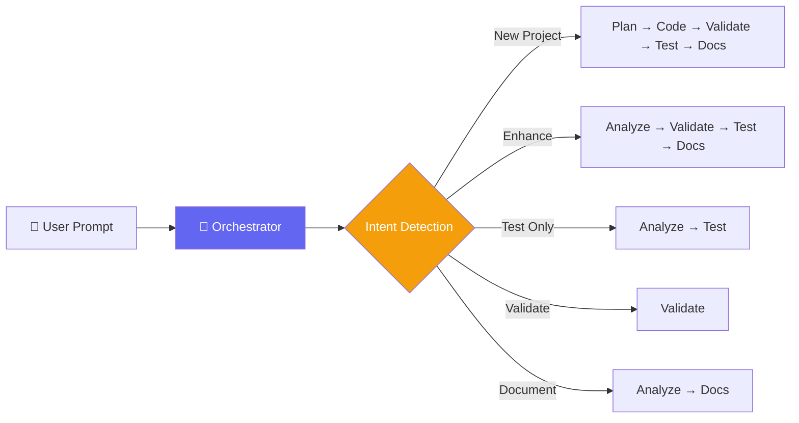

<div align="center">

# 🤖 AI Smart Workflow

### Intelligent Development Workflow Powered by AI Agent Skills

[](LICENSE)
[](https://python.org)
[](docs/supported-agents.md)
[](skills/)

*Transform any Python project from prototype to production-ready with a single prompt.*

</div>

---

## 🎯 What Is This?

AI Smart Workflow is a collection of **AI agent skills** that automate the tedious parts of software development:

- 🔍 **Project Analysis** — Understand codebase structure, dependencies, and quality gaps
- ✅ **Code Validation** — Automated linting, type-checking, and security scanning
- 🧪 **Test Generation** — Comprehensive pytest suites with mocking, fixtures, and edge cases
- 📝 **Documentation** — Docstrings, README, architecture diagrams, and API docs

This is a set of structured instructions that AI coding agents (like [Antigravity](https://deepmind.google) or [Claude Code](https://claude.ai)) read and execute autonomously. You give a natural language prompt, and the AI handles everything.

---

## 🚀 Quick Start

### 1. Install

```bash
git clone https://github.com/Ilia-Habibi/ai-smart-workflow.git
```

### 2. Copy Skills to Your Project

```bash
cp -r ai-smart-workflow/skills/ your-project/skills/
cp ai-smart-workflow/configs/workflow_config.yaml your-project/.workflow-config.yaml
```

### 3. Use with Your AI Agent

Open your project in Antigravity or Claude Code and say:

> "Read the orchestrator skill in `skills/orchestrator/SKILL.md` and run the full workflow on this project."

That's it. The AI takes over from here. ✨

---

## 💡 Usage Examples

### Full Project Enhancement
> "Make this project production ready. Add tests and documentation."

### Targeted Testing
> "Test the database module. Make sure `add_raw_track` rejects duplicates and `update_track_info` handles existing YouTube IDs."

### New Project
> "Build a REST API for task management with FastAPI. Include full tests and documentation."

### Quick Validation
> "Check the code quality of `ocr_handler.py` and fix any issues."

### Custom Test Cases
> "Run tests on the downloader module. Test cases:
> - Downloads should fail gracefully when yt-dlp is not installed
> - Files smaller than 10KB should be rejected
> - Metadata should be properly embedded in the MP3 file"

---

## 📁 Repository Structure

```
ai-smart-workflow/
├── skills/                          # 🧠 AI Agent Skills
│   ├── orchestrator/                # Central workflow coordinator
│   │   └── SKILL.md                 # Intent detection & dispatch
│   ├── analyze-project/             # Project analysis
│   │   ├── SKILL.md                 # Analysis instructions
│   │   └── resources/               # Report templates
│   ├── generate-tests/              # Test generation
│   │   ├── SKILL.md                 # Testing instructions
│   │   ├── examples/                # Sample test files
│   │   └── resources/               # Test pattern reference
│   ├── validate-code/               # Code validation
│   │   ├── SKILL.md                 # Validation instructions
│   │   └── resources/               # Linter/type-checker configs
│   ├── generate-docs/               # Documentation generation
│   │   ├── SKILL.md                 # Documentation instructions
│   │   ├── examples/                # Docstring examples
│   │   └── resources/               # Templates & guides
│
├── configs/                         # ⚙️ Configuration
│   └── workflow_config.yaml         # Customizable settings
│
├── demo/                            # 📊 Before/After Demo
│   ├── before/                      # Original project (no tests/docs)
│   └── after/                       # Enhanced project (full quality)
│
├── docs/                            # 📖 Documentation
│   ├── how-it-works.md              # Architecture & design
│   ├── customization.md             # Configuration guide
│   └── supported-agents.md          # Agent compatibility
│
├── README.md
└── LICENSE
```

---

## 🔄 How It Works



### The Orchestrator
The orchestrator skill is the brain of the system. It:
1. **Parses** your natural language prompt
2. **Classifies** the intent (build, enhance, test, validate, document)
3. **Detects** the scope (whole project, specific module, single function)
4. **Extracts** any test cases from your prompt
5. **Dispatches** specialized sub-agents for each phase
6. **Coordinates** results and produces a final report

> See [How It Works](docs/how-it-works.md) for detailed architecture documentation.

---

## 🧪 Demo: PlaylistPirate

The `demo/` directory contains a real-world before/after example using [PlaylistPirate](https://github.com/Ilia-Habibi/Playlist-Pirate) — a Python pipeline that extracts songs from mobile screenshots and downloads them as tagged MP3s.

### Before (Original)
- ❌ No tests
- ❌ No type hints  
- ❌ No linting configuration
- 🟡 Basic README and docstrings

### After (Enhanced by AI Smart Workflow)
- ✅ Comprehensive pytest suite (31 unit tests, 92% coverage, 100% passing)
- ✅ Full type annotations (MyPy passing with 0 errors)
- ✅ Ruff configured and passing (0 lint errors)
- ✅ Professional README with architecture diagrams
- ✅ Google-style docstrings on public functions
- ✅ Fully mocked unit tests guaranteeing complete test isolation

---

## ⚙️ Configuration & Override Protocol

The workflow can be customized per project using YAML configuration, evaluated through a **3-tier precedence hierarchy**:

```
[1. User Prompt Directives]  --> Highest priority (e.g. "aim for 85% coverage")
          ↓
[2. Project Config File]    --> `.workflow-config.yaml` or `configs/workflow_config.yaml`
          ↓
[3. Built-in Skill Defaults] --> Fallback parameters defined in skills
```

Customize the workflow by copying and editing [`configs/workflow_config.yaml`](configs/workflow_config.yaml):

```yaml
testing:
  min_coverage: 70              # Minimum test coverage %
  mock_strategy: always_mock    # Strict unit test isolation
  
validation:
  linter: ruff                  # Linting tool
  auto_fix: true                # Auto-fix issues
  line_length: 120              # Max line length

documentation:
  docstring_style: google       # Docstring format
  generate_readme: true         # Auto-generate README
```

> For full configuration details and runtime override examples, see the [Customization Guide](docs/customization.md).

---

## 🤝 Supported AI Agents

| Agent | Support Level | Setup |
|-------|--------------|-------|
| **Google Antigravity** | ⭐ Full | Native SKILL.md support |
| **Claude Code** | ⭐ Full | Reference skills in CLAUDE.md |
| **Cursor AI** | 🟡 Partial | Via .cursorrules |
| **GitHub Copilot** | 🟡 Partial | Via copilot-instructions.md |

> See [Supported Agents](docs/supported-agents.md) for detailed setup instructions.

---

## 📄 License

This project is licensed under the MIT License — see the [LICENSE](LICENSE) file for details.

---

<div align="center">

**Built with ❤️ and AI**

*If you find this useful, please ⭐ the repo!*

</div>
