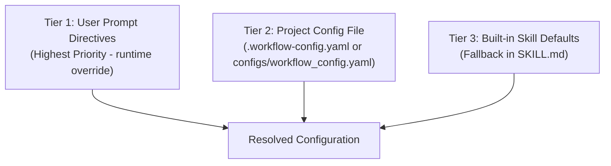

# Customization Guide

## Overview

The AI Smart Workflow is designed to be highly customizable. You can adjust behavior through the config file, modify individual skills, or create entirely new skills.

---

## Configuration Loading & Overrides Protocol

The workflow follows a predictable **3-tier precedence hierarchy** to determine runtime parameters:



### 1. Precedence Hierarchy

1. **Tier 1 — Explicit User Prompt (Highest Priority):**
   Any directive provided in the user's natural language prompt takes immediate precedence over files and defaults.
   - *Example prompt:* `"Run the workflow on this project, but aim for 85% coverage and skip bandit security scans."`
   - *Result:* Overrides `testing.min_coverage` to `85` and disables `validation.security_scanner`, while retaining all other settings from the configuration file.

2. **Tier 2 — Project Configuration File (Second Priority):**
   When the orchestrator starts, it automatically searches for:
   - `.workflow-config.yaml` in the target project root
   - `configs/workflow_config.yaml`
   If found, the AI agent parses the YAML structure and propagates parameters across all delegated skills.

3. **Tier 3 — Built-in Defaults (Fallback):**
   If no configuration file exists and no prompt overrides are given, the workflow safely falls back to standard production defaults:
   - `validation.linter`: `ruff` (with auto-fix enabled)
   - `validation.type_checker`: `mypy`
   - `testing.min_coverage`: `70%`
   - `testing.mock_strategy`: `always_mock` (strict unit test isolation)
   - `documentation.docstring_style`: `google`

---

## Configuration File Reference

The template configuration is located at [`configs/workflow_config.yaml`](../configs/workflow_config.yaml). To customize your project, copy it to your project root as `.workflow-config.yaml`:

```bash
cp configs/workflow_config.yaml .workflow-config.yaml
```

### Key Settings

#### Validation Rules

```yaml
validation:
  linter: ruff           # or: flake8, pylint
  type_checker: mypy     # or: pyright, pytype
  line_length: 100       # adjust to team preference
  auto_fix: true         # auto-fix lint issues
  
  ruff_rules:            # choose which rule sets to enable
    - "E"                # pycodestyle errors
    - "F"                # pyflakes
    - "I"                # isort
    - "B"                # flake8-bugbear
```

#### Testing Preferences

```yaml
testing:
  min_coverage: 70                   # minimum acceptable coverage %
  naming_convention: test_descriptive # or: test_given_when_then
  mock_strategy: always_mock         # or: selective_mock, minimal_mock
  generate_integration_tests: true
  generate_edge_case_tests: true
  exclude_from_testing:              # skip certain modules
    - "migrations/"
    - "scripts/"
```

#### Documentation Style

```yaml
documentation:
  docstring_style: google    # or: numpy, sphinx
  generate_readme: true
  generate_contributing: true
  generate_architecture_diagram: true
```

---

## Creating Custom Skills

### Skill Structure

```
my-custom-skill/
├── SKILL.md            # Required: instructions for the AI agent
├── scripts/            # Optional: helper scripts
├── examples/           # Optional: reference code
└── resources/          # Optional: templates, configs
```

### SKILL.md Template

```markdown
---
name: "my-custom-skill"
description: "What this skill does in one sentence"
triggers:
  - "keyword or phrase that activates this skill"
  - "another trigger phrase"
---

# Skill Name

## Purpose
What this skill accomplishes.

## When to Use
Under what conditions should this skill be activated.

## Prerequisites
What needs to be in place before running.

## Instructions
Step-by-step instructions for the AI agent.
Be specific, clear, and unambiguous.

## Output
What artifacts or changes this skill produces.

## Quality Checklist
How to verify the skill executed correctly.
```

### Tips for Writing Good Skills

1. **Be specific**: "Run `ruff check .`" is better than "check the code"
2. **Handle edge cases**: What if the project has no tests? No README?
3. **Provide examples**: Show the AI what good output looks like
4. **Set quality bars**: Define minimum thresholds for quality metrics
5. **Include verification**: How to confirm the skill worked correctly

---

## Adding Project-Specific Overrides

For project-specific customization, create a `.workflow/config.yaml` in your project root:

```yaml
# .workflow/config.yaml — Project-specific overrides

testing:
  min_coverage: 85              # higher bar for this project
  exclude_from_testing:
    - "legacy/"                  # skip legacy code
  
validation:
  line_length: 120              # this project uses longer lines

documentation:
  docstring_style: numpy        # this project uses NumPy style
```

The workflow will merge project-level config with the default config, with project settings taking priority.

---

## Extending the Workflow

### Adding a New Phase

1. Create a new skill directory under `skills/`
2. Write the `SKILL.md` with clear instructions
3. Update the orchestrator's `SKILL.md` to include your new phase in the execution plan
4. Add relevant config options to `workflow_config.yaml`

### Example: Adding a "Performance Profiling" Skill

```
skills/profile-performance/
├── SKILL.md
└── scripts/
    └── profile.py
```

Then update the orchestrator to recognize triggers like "profile this", "check performance", "optimize speed".
