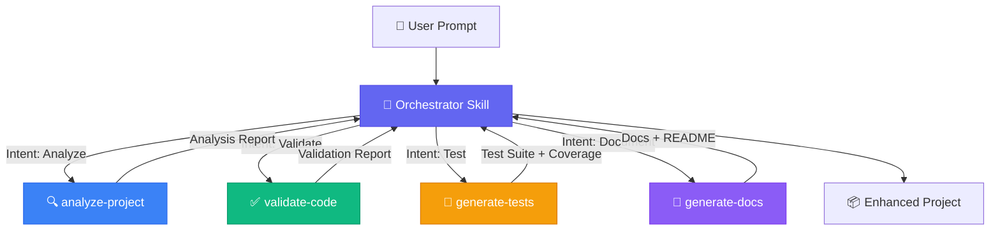
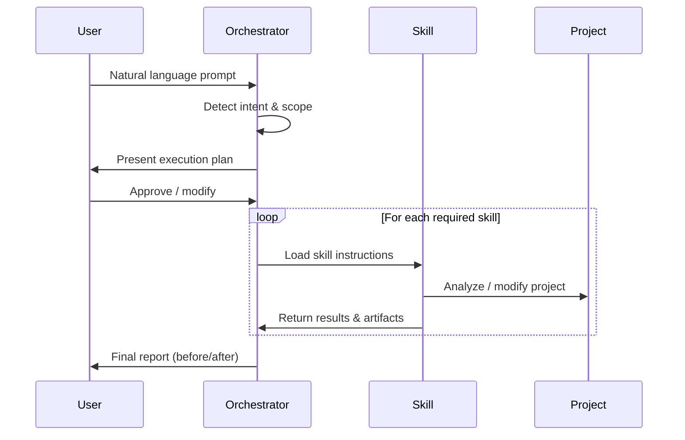
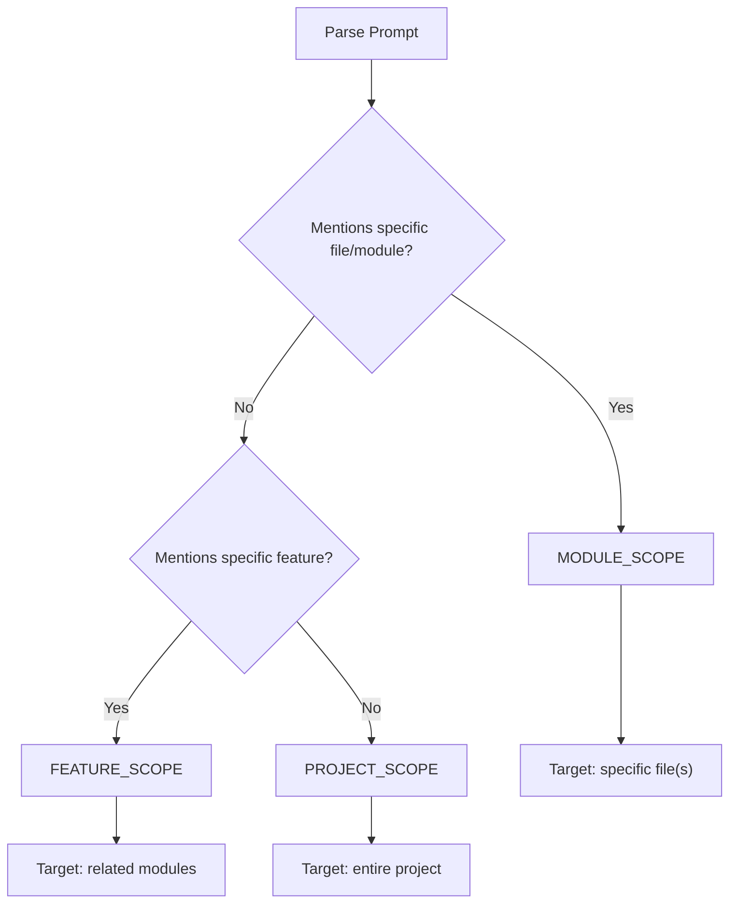

# How It Works — Architecture Guide

## Overview

The AI Smart Workflow is a **skill-based orchestration system** designed for AI coding agents (Antigravity, Claude Code). Instead of a traditional CLI tool, it provides **structured instructions (Skills)** that the AI agent reads, understands, and executes autonomously.



## Skill Architecture

### What is a Skill?

A **Skill** is a self-contained instruction bundle that teaches an AI agent how to perform a specific task. Each skill contains:

| Component | File | Purpose |
|-----------|------|---------|
| **Instructions** | `SKILL.md` | Step-by-step guide for the AI agent |
| **Scripts** | `scripts/` | Helper automation scripts |
| **Examples** | `examples/` | Reference implementations |
| **Resources** | `resources/` | Templates, configs, and data |

### How Skills Work

1. **Discovery**: The orchestrator reads skill metadata (YAML frontmatter) to understand what each skill does
2. **Selection**: Based on user intent, the orchestrator selects which skills to activate
3. **Loading**: Only relevant skills are loaded into the agent's context (progressive disclosure)
4. **Execution**: The agent follows the skill's instructions step-by-step
5. **Reporting**: Each skill produces structured output (reports, files, configs)

### Skill Lifecycle



## Intent Detection

The orchestrator uses a **pattern-matching + context analysis** approach:

### Signal Analysis

```
User Prompt → Extract Keywords → Match Patterns → Determine Mode
                                                  → Determine Scope
                                                  → Extract Test Cases
```

### Decision Matrix

| User Says | Detected Mode | Skills Activated |
|-----------|--------------|-----------------|
| "Build me a REST API" | `FULL_BUILD` | All skills |
| "Make this production ready" | `ENHANCE` | analyze → validate → test → docs |
| "Add search feature" | `MODIFY` | analyze → code → validate → test |
| "Test the database module" | `TEST_ONLY` | analyze (targeted) → test |
| "Check code quality" | `VALIDATE_ONLY` | validate |
| "Write documentation" | `DOCUMENT_ONLY` | analyze → docs |

### Scope Resolution



## Sub-Agent Coordination

The orchestrator dispatches **sub-agents** (via the AI platform's sub-agent mechanism) for each phase:

### Parallel Execution
Independent phases run simultaneously:
- Validation and Documentation (no dependencies between them)
- Multiple test files for different modules

### Sequential Execution  
Dependent phases wait for predecessors:
- Testing waits for code to be written
- Documentation waits for the project to be analyzed

### Error Recovery
- If a phase fails, the orchestrator continues with remaining phases
- Failed phases are retried once with adjusted parameters
- Final report clearly marks succeeded vs failed phases

## Quality Assurance

Every workflow run produces measurable metrics:

| Metric | Before | After | Target |
|--------|--------|-------|--------|
| Test Coverage | 0% | 72%+ | 70% min |
| Lint Issues | ? | 0 | 0 |
| Type Coverage | 0% | 80%+ | 50% min |
| Doc Coverage | ? | 100% | 100% public |
| Security Issues | ? | 0 high | 0 high/critical |
