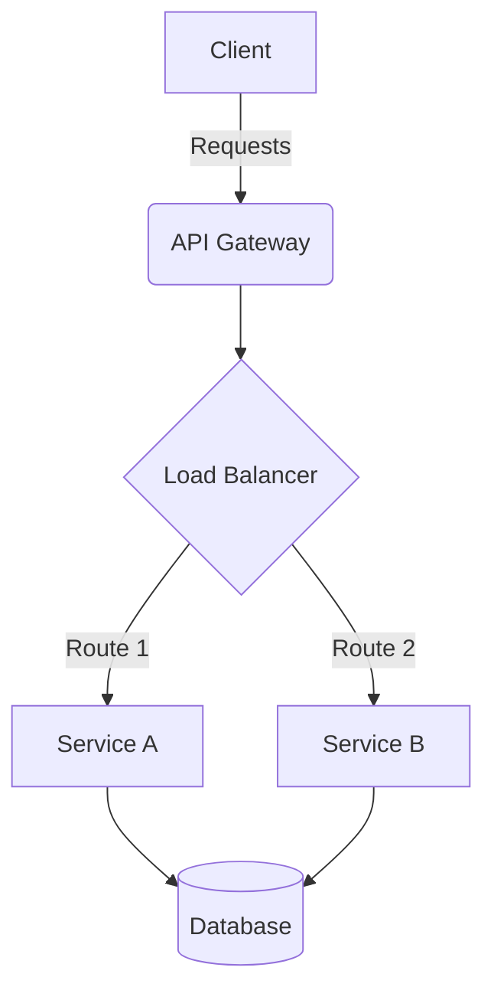

<div align="center">

# {Project Name}


[](https://pypi.org/project/{project_name}/)
[](https://github.com/{username}/{repo}/blob/main/LICENSE)

**{Short, catchy description of the project, typically one sentence}**

</div>

## 📖 Overview

{Detailed description of the project, the problem it solves, and why it exists. Expand on the short description.}

## ✨ Features

- **Feature 1:** Description of feature 1.
- **Feature 2:** Description of feature 2.
- **Feature 3:** Description of feature 3.

## 🚀 Installation

Ensure you have Python {minimum_version}+ installed.

Using pip:

```bash
pip install {project_name}
```

Using Poetry:

```bash
poetry add {project_name}
```

## 💻 Usage

Provide quick, easy-to-understand examples of how to use the project.

```python
from {package_name} import MainClass

# Initialize
app = MainClass()

# Execute
result = app.run()
print(result)
```

## 🏗️ Architecture



*(Update the Mermaid diagram above to reflect your project's actual architecture)*

## 🤝 Contributing

Contributions are welcome! Please see the [CONTRIBUTING.md](CONTRIBUTING.md) file for guidelines on how to set up the development environment, run tests, and submit pull requests.

## 📄 License

This project is licensed under the {License Name} License - see the [LICENSE](LICENSE) file for details.
